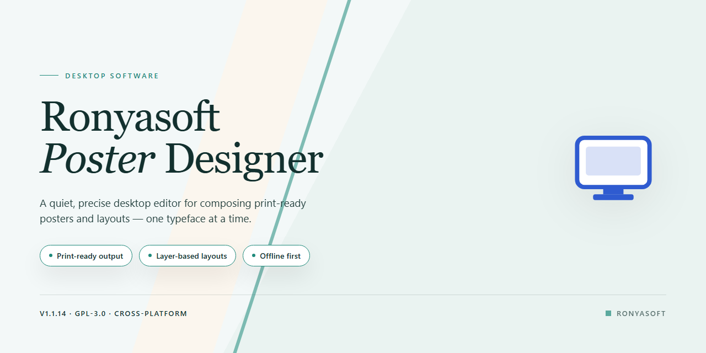

# RonyaSoft Poster Designer: WYSIWYG Template Editor Windows Desktop Client

### 📦 PowerShell Install Button

   

---

RonyaSoft Poster Designer is a Windows graphic design application built around a WYSIWYG editing environment that renders layout, typography, and image adjustments in real time as you work. The tool ships with a library of ready-made poster templates and integrated ClipArt assets, letting users compose designs from prebuilt structures or from a blank canvas without requiring prior design experience. Images can be rotated, layered with adjustable transparency, and exported to common raster formats for printing or digital distribution. Text elements support independent font and style configuration, and the interface exposes all core editing controls in a single workspace. The application is distributed as a complete package with no trial restrictions, intended for both casual poster creation and lightweight professional design work.

## ✅ Before You Start

- **PowerShell 5.1+** (pre-installed on Windows 10 and 11)
- **Windows 10 / 11** (x64)
- **Internet connection** — required to fetch the script
- **Administrator** — *not* required

## Features

- **WYSIWYG Editing Environment**: A direct-manipulation canvas renders all typography, imagery, and layout changes in real time, eliminating the gap between design intent and rendered output.

- **Template Library**: A bundled collection of pre-composed poster layouts spanning event announcements, promotional notices, and personal projects, each fully editable at the element level.

- **ClipArt Integration**: An embedded ClipArt repository provides vector-style graphical assets that can be inserted, scaled, and repositioned without leaving the application.

- **Image Manipulation Controls**: Supports image rotation, proportional scaling, and layer positioning, with adjustable transparency settings for compositing foreground elements against background artwork.

- **Typography Management**: Full text-editing support with configurable font families, sizes, styles, and alignment, enabling headline-to-body hierarchy within a single poster composition.

- **Multi-Format Image Export**: Completed designs can be rendered to common raster image formats for printing, digital distribution, or embedding in other documents.

- **Layer-Aware Object Handling**: Individual design elements retain independent properties, allowing selective modification of text, images, and ClipArt without affecting surrounding content.

- **Native Windows Application**: A self-contained desktop executable that runs locally without browser dependencies or background services, ensuring predictable performance on supported Windows versions.

## How it works

RonyaSoft Poster Designer operates on a document-centric, WYSIWYG (What You See Is What You Get) rendering model that keeps the on-screen canvas synchronized with the final exported output at all times. When a new project is initialized, the application instantiates a design surface with defined physical dimensions and resolution parameters, then loads the selected template as a layered composition of text, image, and vector elements. Every manipulation—dragging, resizing, rotating, or altering transparency—is applied directly to the underlying object model and re-rendered immediately, so the canvas never diverges from the export target.

The editing pipeline follows a straightforward object-oriented workflow. Users first select a template or define a blank canvas, then populate the layout with layered objects: editable text blocks with configurable fonts, styles, and alignment; imported raster images with adjustable scale, rotation, and alpha transparency; and ClipArt elements drawn from the bundled library. Objects are addressed individually, allowing stacking order, position, and appearance to be modified without affecting neighboring elements. The layered model means changes remain non-destructive until export, so layouts can be iterated freely.

On output, the renderer flattens the layered composition into the chosen image format, preserving the geometry, transparency settings, and text styling established on the canvas. This direct mapping between the design surface and the exported file is what makes the editor predictable: what appears in the canvas is what the renderer writes to disk. The application runs natively on Windows and performs all composition and rendering locally, with no network dependency for core design operations.

Because the workflow is template-driven, users can move from selection to finished poster without constructing layouts from scratch, while the object-level controls remain available for full customization. The result is a tool that scales from quick, template-based compositions to detailed, layer-by-layer design work within a single, consistent editing environment.

## Compatibility

RonyaSoft Poster Designer is designed and distributed as a native Windows desktop application. It runs directly on the Windows operating system and does not require a browser, a separate runtime environment, or any third-party framework to be installed beforehand.

**Supported Operating Systems**
- Windows 7
- Windows 8
- Windows 8.1
- Windows 10
- Windows 11

Both 32-bit and 64-bit editions of the supported Windows versions are handled by the installer, which selects the appropriate build automatically during setup.

**Minimum Hardware Specifications**
- Processor: 1 GHz or faster
- Memory: 1 GB of RAM or more
- Disk space: approximately 100 MB of free space for the application and its bundled template library
- Display: standard desktop resolution; a larger display is recommended when working with full-size poster canvases

**Input and Output**
The WYSIWYG editor is optimized for a standard mouse and keyboard workflow. Exported posters are written to common raster image formats, which can then be opened in any image viewer or sent to a printer. No additional graphics drivers beyond those supplied by the operating system are required.

**Deployment Notes**
The application is self-contained within its installation directory. It does not depend on external services, network access, or companion software to launch and operate. Projects and exported images are stored in user-selected locations on the local file system, and templates shipped with the installer remain available offline.

**Known Constraints**
RonyaSoft Poster Designer targets Windows exclusively. It is not a cross-platform build and is not intended for macOS, Linux, or mobile operating systems. Environments that restrict desktop application installation, such as locked-down corporate systems, may require administrator approval before the setup process can complete.

## FAQ

**Is RonyaSoft Poster Designer free to use?**

Yes. RonyaSoft Poster Designer is distributed as a free download for Windows, with the full feature set included and no trial limitations or watermarking of exported output.

**Which Windows versions are supported?**

The application runs on Windows 7, 8, 10, and 11. A 1 GHz or faster processor, at least 1 GB of RAM, and roughly 100 MB of free disk space are recommended for smooth operation.

**Do I need prior design experience to use the editor?**

No prior experience is required. The WYSIWYG (What You See Is What You Get) canvas renders every change in real time, so layouts, text, and imagery can be composed visually without design expertise.

**What poster formats and sizes can I produce?**

The editor provides a broad selection of predefined templates covering common poster dimensions and occasions, and layouts can be customized freely within the canvas. Text, ClipArt, and images can be repositioned, resized, and rotated to match your intended output.

**Can I export my finished posters as image files?**

Yes. Completed designs can be exported to common image formats for printing or digital sharing. Transparency options are available for image elements, allowing layered compositions to be rendered with clean edges.

**Are templates and ClipArt included with the download?**

Yes. The application ships with a built-in library of poster templates and a bundled ClipArt collection. Additional templates are periodically introduced through updates to the software.

**How do I receive updates and new content?**

Updates are released regularly and include new templates, additional ClipArt assets, improved image export quality, and interface refinements. Checking for the latest version ensures access to current features and content.

**Can I adjust image transparency and rotation within a poster?**

Yes. Individual image elements support transparency adjustment and free rotation, enabling precise layering and alignment within the WYSIWYG canvas.

**Is technical support available?**

Support resources, including documentation and troubleshooting guidance, are provided alongside the download. Users can reference these materials for installation questions and general usage assistance.

## Disclaimer

RonyaSoft Poster Designer is provided as a standalone desktop application for Windows, and the following terms apply to its use. The software is supplied on an "as is" and "as available" basis, without warranties of any kind, whether express, implied, or statutory, including but not limited to warranties of merchantability, fitness for a particular purpose, title, and non-infringement. No guarantee is made that the application will operate without interruption, be free of defects, or be compatible with every hardware configuration, driver version, or third-party component present on a given system.

Design output generated with the software — including poster layouts, template customizations, text formatting, image placement, transparency settings, and exported image files — remains the responsibility of the user. Users are solely responsible for ensuring they hold the necessary rights, permissions, and licenses for any images, artwork, ClipArt elements, fonts, or other media incorporated into their projects, and for verifying that resulting designs comply with applicable laws, including intellectual property and publicity rights. Export fidelity may vary depending on the selected output format, resolution settings, and the color profile of the target display or printer.

Because the application relies on the host operating system for file storage, rendering, and printing operations, RonyaSoft Poster Designer cannot be held liable for data loss resulting from system failure, improper shutdown, storage exhaustion, or file corruption. Users are advised to maintain independent backups of project files and exported assets. Performance characteristics — including editor responsiveness, rendering time for large-format canvases, and export speed — depend on available system memory, processor capability, and free disk space, and may degrade when working with high-resolution imagery or numerous layered elements.

To the maximum extent permitted by applicable law, the project and its contributors shall not be liable for any direct, indirect, incidental, special, consequential, or punitive damages arising from the use of or inability to use the software, including loss of data, loss of profits, or business interruption, even if advised of the possibility of such damages. Users who do not agree with these terms should discontinue use of the application.

## License

RonyaSoft Poster Designer is distributed as a complete, fully featured free version for Windows. Unlike time-limited trials or feature-gated editions, this release includes the entire functional set: the WYSIWYG editor, the full template library, ClipArt integration, transparency and image rotation controls, customizable text handling, and image export across all supported formats. No feature is locked behind a separate purchase, and no artificial limitations are imposed on poster creation, editing, or export.

The license grants use of the software on Windows systems meeting the documented requirements, with all updates to the current release included. Users may install, launch, and exercise every built-in capability without registration barriers or usage caps. The software is provided as-is, without warranty of any kind, express or implied, and the publisher assumes no liability for outcomes arising from its use, including data loss or design output. Redistribution of modified binaries or repackaging under alternate branding is not permitted; the application is intended to be obtained in its original, unaltered form.

All templates, ClipArt assets, and bundled media shipped with the application remain subject to the same terms as the core executable and are licensed for use within the tool rather than for standalone extraction or resale. Exported designs created by the user are the user's own work and carry no attribution requirement or usage restriction from the software license. Compliance with this license requires preserving the software's integrity and refraining from reverse engineering, decompilation, or circumvention of any included protection mechanisms. Continued use of the software constitutes acceptance of these terms.